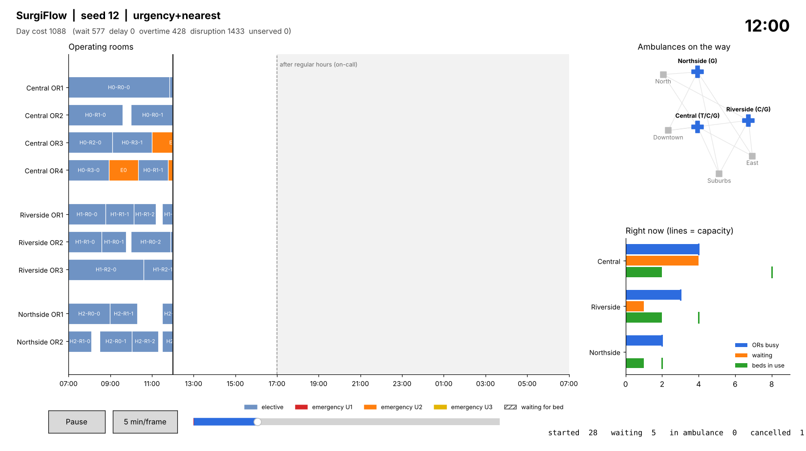

## Setup

We use the course conda environment (Python 3.14).

```bash
conda create -n FAI python=3.14 -c conda-forge   # skip if you already have it
conda activate FAI
pip install -r requirements.txt
pip install -e .      # makes `import surgiflow` work everywhere
```

## Evaluate

Compare methods on the same seeded days:

```bash
python scripts/evaluate.py                        # all methods, 50 days, all CPU cores
python scripts/evaluate.py --seeds 200
python scripts/evaluate.py --methods fifo+nearest urgency+nearest
```

Prints a summary table and saves `results/eval_<timestamp>/` (per-day results, summary, head-to-head comparison, run info). Add new methods in `src/surgiflow/evaluation/methods.py`.

## Demo

Replay a simulated day: ORs, ambulances, queues and beds, animated.

```bash
python scripts/demo.py                                   # interactive window
python scripts/demo.py --seed 12 --method urgency+nearest
python scripts/demo.py --save results/demo.gif           # export for slides (~2 min)
```

Controls: space = play/pause, right/left = faster/slower, home = restart, drag the slider to jump in time.



## Repository structure

```
configs/               simulation parameters (hospitals, ORs, beds, arrival rates)
src/surgiflow/sim/     simulator: hospitals, patients, events, environment
src/surgiflow/agents/  baselines, search (SA/GA), RL (Q-learning/SARSA)
src/surgiflow/evaluation/  metrics and plots
scripts/               entry points: experiments, training, cluster jobs
tests/                 tests
report/                LaTeX writeup
results/               experiment outputs (not committed)
```

## Workflow

- Never push to `main`; work on your branch and open a PR.
- Sync with main at the start of every session: `git fetch origin && git merge origin/main`.
- Put `Closes #N` in the PR description to close the issue.
- Merge with "Create a merge commit" (not squash).
