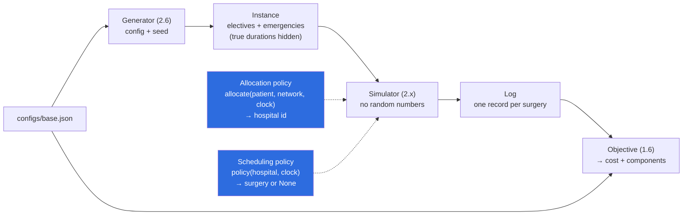

# Pipeline and ownership (task 1.5)

All randomness happens in the generator. The simulator is deterministic, so
every method is scored on exactly the same days.

Blue boxes are the plug-ins: baselines (2.7, 2.8), SA/GA (3.x), and RL (4.x) all
provide these same two functions.
